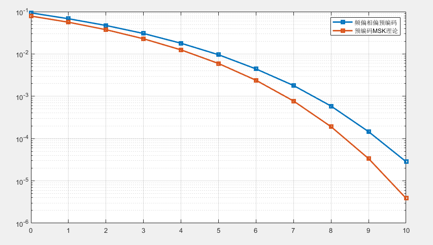
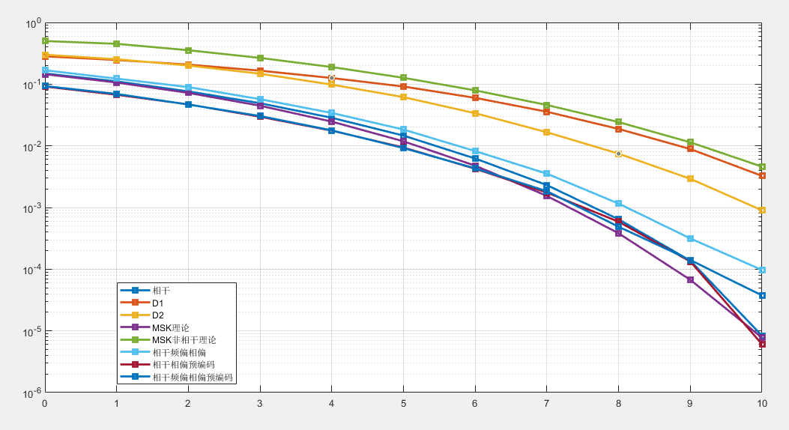
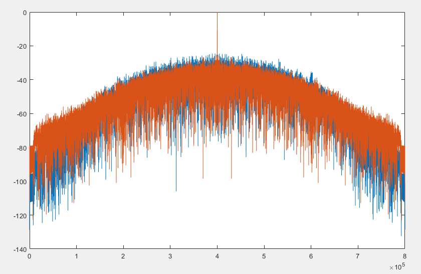

# ISAC Communication + Radar Crossover! Comprehensive Analysis of CPM/MSK/GMSK-LFM Hybrid Signals with MATLAB Code

1. Research Background and Purpose: In modern communication and radar systems, it is common to combine digitally modulated signals (used for information transmission) with linear frequency modulation (LFM) signals (used for ranging or jamming resistance). This paper compares the autocorrelation characteristics and spectrum characteristics of continuous phase modulation (CPM), minimum frequency shift keying (MSK), Gaussian minimum frequency shift keying (GMSK), and their combination with LFM through simulations. It analyzes the performance differences among different modulation methods in composite signals, providing a theoretical basis for system design.
2. Core Modulation Technology Principles: 2.1 Continuous Phase Modulation (CPM): The core characteristic of CPM is phase continuity, avoiding the spectral broadening caused by phase jumps in keying modulation. Its baseband signal expression is:
where:
•  
is the modulation symbol (binary);
•  
is the modulation index (determines the phase change rate, this paper);
•  
is the pulse shaping function (support interval, denoted as the correlation length, this paper, indicating the influence of previous symbols on the current symbol);
•  
is the symbol period, is the initial phase.
The pulse shaping function must satisfy the normalization condition to ensure that the phase change at the end of each symbol is continuous (the key of continuous phase).
2.2 Minimum Frequency Shift Keying (MSK): MSK is a special case of CPM: , where the pulse shaping function is a rectangular pulse:
Substituting the CPM expression into MSK's equation, the phase of MSK is: its instantaneous frequency is the derivative of the phase: binary, so the frequency jumps are, and the jump value is 1/4 of the symbol rate (when, the jump is, and the jump value is, which meets the "minimum frequency" characteristic.
2.3 Gaussian Minimum Frequency Shift Keying (GMSK): GMSK is an improvement of MSK, smoothing the rectangular pulse through a Gaussian filter to reduce sidelobes in the spectrum. Its pulse shaping function is the convolution of a Gaussian pulse and the MSK rectangular pulse: where is the impulse response of the Gaussian filter: is the product of the 3dB bandwidth of the Gaussian filter and the symbol rate (lesser, the faster the sidelobe attenuation, but increased ISI).
2.4 Linear Frequency Modulation (LFM) signal The instantaneous frequency of LFM signals linearly changes with time. The expression is: where: - represents the carrier frequency (in this article). - Frequency modulation slope For bandwidth. For pulse width. (This article).
The autocorrelation function of LFM has sharp peaks, suitable for ranging; its spectrum is approximate to a rectangle, with a bandwidth.
3. Compound Signal Model: The digitally modulated signal and LFM are combined as follows:
Compliance
Number
Words
Among them, the number is...
Words
For CPM/MSK/GMSK baseband signals (through oversampling discrete), the composite signal retains the information transmission capability of digital modulation and the anti-interference/range measurement characteristics of LFM.
4. Characteristic Analysis Method
4.1 Autocorrelation Function (ACF)
The autocorrelation function describes the similarity between a signal and its delayed version, defined as: after discretization. calculated through a function. Or utilize FFT to realize efficiently (convolution theorem): The sharpness of the auto-correlation peak reflects the time resolution ability of the signal. Side lobes affect the interference performance.
4.2 Spectral Characteristics: The spectrum of the signal is obtained through Fourier transform: after discrete, it is calculated for analysis of the frequency distribution, bandwidth, and sidelobe attenuation characteristics (e.g., 30dB bandwidth).
5. Simulation Design Idea: By generating binary random data (edges fixed at 1/0 to analyze boundary effects), modulate them into CPM/MSK/GMSK baseband signals, and then multiply with LFM to obtain the composite signal. The final comparison includes: - Autocorrelation function: Peak Sidelobe Ratio (PSLR), Mainlobe Width; - Spectrum: 3dB/30dB bandwidth, Sidelobe Decay Rate; - Demodulation performance under frequency offset conditions (needs to add a module for frequency offset estimation and compensation).
The MATLAB code below is mainly used to analyze the auto-correlation and spectrum characteristics of three modulation signals: CPM, MSK, GMSK combined with LFM (Linear Frequency Modulation). Below are the interpretations of the code and suggestions for your "To Do" list.
Code Core Functionality Analysis 1
Parameter settings: Defines key parameters such as CPM (Modulation Index h, Correlation Length L), LFM (Bandwidth B, Slope K), and sampling rate (oversample factor).
2  
Signal generation:
•  
Generate binary random data (90 symbols at both ends, for edge analysis).
•  
Call the custom modulation function (MSKmod, CPMmod, GMSK_mode_new) to generate the baseband signal.
•  
Multiply the baseband signal with LFM signals to obtain bandpass modulation signals (MSK_LFM, CPM_LFM, GMSK_LFM).
1  
Feature Analysis:
•  
Compute the autocorrelation function (xcorr directly or FFT for efficient computation).
•  
Compute spectrum (fftshift + fft).
•  
The average of the results achieved multiple times (Ne=1 is currently not effective, which can be increased to smooth the results).
Implementation suggestions for "To Do" 1. Compared with MSK, MSK is a special case of CPM (h=0.5, L=1, rectangular pulse), which can be compared from the following perspectives:
•  
Spectral Characteristics: MSK has a faster sidelobe attenuation than CPM, but GMSK (Gaussian Filtered MSK) is even better. Add quantization metrics (such as 30dB bandwidth) to the existing spectrum chart.
% Calculate the 30dB bandwidth (example)
\[\~, idx\_cpm] = find(20*log10(CPM_LFM_FFT./max(CPM_LFM_FFT)) > -30);
bw_cpm = (max(idx_cpm) - min(idx_cpm)) * (fs / length(CPM_LFM_FFT)); % Convert to frequency units
•
Autocorrelation Characteristics: MSK has sharper autocorrelation peaks, which can be compared with sidelobe ratio (PSLR).
2. Calculation of CPM Rates
Symbol rate: The symbol rate is defined in the code as sym_rate = 1/Ts (where Ts = Tp/nn, and units are consistent with fs, e.g., MHz⁻¹ equals μs).
•
Bit rate: If the CPM is binary (data is 0/1), then the bit rate = symbol rate (1 bit per symbol). If it is M-ary, then the bit rate = symbol rate × log2(M).
bit\_rate = sym\_rate; % Binary case
fprintf('CPM bit rate: %.2f symbols/μs\n', bit\_rate);
3. In the presence of frequency offset, refine the demodulation code. Currently, only modulation is implemented, and it is necessary to add a demodulation module and handle frequency offset:
•  
Step 1: Remove LFM Carrier  
The receiving end first performs the signal and local LFM conjugate multiplication to obtain the baseband CPM signal.
% Assuming the received signal contains a frequency offset f0 = 0.5; % Frequency offset (unit: MHz) rx\_signal = CPM\_LFM .* exp(1i*2*pi*f0*t); % The received signal with baseband frequency offset baseband\_rx = rx\_signal .* conj(LFM); % Remove LFM
•
Step 2: Frequency Offset Estimation and Compensation
Estimate the frequency offset using FFT or a phase-locked loop (PLL), for example:
% FFT frequency offset estimation fft\_base = fft(baseband\_rx); \[\~, f\_idx] = max(abs(fft\_base)); f\_est = (f\_idx - 1) \* fs / length(baseband\_rx) - fs/2; % Estimated frequency offset baseband\_compensated = baseband\_rx * exp(-1i*2*pi*f_est*t); % Compensation
Step 3: CPM Demodulation
Viterbi algorithm (considering the memory of CPM, state number is 2^(L-1)) is used for demodulation. MATLAB's cpmmod/cpmdemod can be called to verify custom functions.
4. Frequency Exposure (Time-Frequency Analysis) Observe the change in signal frequency with time by Short Time Fourier Transform (STFT).
Figure;% Analyze the time-frequency characteristics of CPM\_LFM win = hamming(256); % Window function overlap = 128; % Overlap points nfft = 512; spectrogram(CPM\_LFM, win, noverlap, nfft, fs, 'yaxis');title('CPM-LFM Time-Frequency Figure');colorbar;
Comparing the time-frequency plots of MSK and GMSK, one can intuitively see the linear frequency modulation trend of LFM superimposed with the frequency hopping effect of digital modulation.
5. CE-OFDM (Constant Envelope OFDM) Analysis with CE-OFDM modulation and comparison with existing signals:
• CE-OFDM generation (core is to perform phase modulation on the OFDM signal to maintain constant envelope):
% Simplified example: OFDM baseband -> constant envelope conversion N_fft = 64; % FFT points cp_len = 16; % Circular prefix length data_ofdm = randi([0 1], 1, N_fft); % OFDM data ofdm_mod = ifft(fftshift(data_ofdm)); % OFDM modulation ofdm_cp = [ofdm_mod(end - cp_len + 1 : end), ofdm_mod];% Adding a loop prefix ce_ofdm = exp(1i*angle(ofdm_cp)); % Envelope-envelope processing (only retaining phase) ce_ofdm_LFM = ce_ofdm .* LFM(1:length(ce_ofdm)); % Combining with LFM
•
Feature comparison: Calculate the auto-correlation and spectrum of CE-OFDM-LFM, compare with CPM/LFM etc. The peak to average power ratio (PAPR) and spectral efficiency.
Code optimization suggestion 1
Ensure that custom modulation functions (such as MSKmod) are correctly implemented: For example, the phase shift of MSK should meet continuous phase (π/2 per symbol).
2  
Increase Ne (e.g., Ne=100), to make the autocorrelation and spectral results smoother.
3  
Improved Drawing Labels: Add horizontal axis (delay / frequency) and vertical axis (amplitude dB), specify units (such as μs, MHz).
Through the above supplement, we can systematically compare the performance of various modulations combined with LFM and solve issues such as frequency offset demodulation and time-frequency analysis.
\n  
.rtcContent { padding: 30px; } .lineNode {font-size: 16pt; font-family: Menlo, Monaco, Consolas, "Courier New", monospace; font-style: normal; font-weight: normal; }clear all;close all;% To Do: compare with MSK; calculate the rate of CPM(Improved demodulation under frequency offset conditions); frequency reveal; CE-OFDM% CPM parameterh = 0.5; % modulation numberL = 2;   % related lengthnn = 5000; % No. of modulate codeTp = 50;  % LFM time widthTs = Tp/nn;% symbol time widthsym_rate = 1/Ts;% LFM parameterB = 100; % Band width MHzK = B/Tp;  % FM slope MHz/mus B/Tpfc = 100; % carry frequence MHz oversample = 80;fs = sym_rate * oversample; % sample frequence MHz data = randi([0 1], [1 nn]);data(1:90) = 1;data(end-89:end) = 0;MSK_BB = MSKmod(data, oversample);CPM_BB = CPMmod(data, oversample);GMSK_BB = GMSK_mode_new(data, oversample);t = -0.5*Tp : 1/fs: 0.5*Tp - 1/fs;t = t + 1/fs/2;LFM = exp(1i*K*pi*t.^2);MSK_LFM = MSK_BB .* LFM;CPM_LFM = CPM_BB .* LFM;GMSK_LFM = GMSK_BB .* LFM;LFM_AF = xcorr(LFM, LFM);Ne = 1;MSK_LFM_FFT = zeros(size(LFM));CPM_LFM_FFT = zeros(size(LFM));GMSK_LFM_FFT = zeros(size(LFM));MSK_LFM_AF = zeros(size(LFM_AF));CPM_LFM_AF = zeros(size(LFM_AF));GMSK_LFM_AF = zeros(size(LFM_AF));% signal = GMSK_LFM;% signal_reverse = (fliplr(signal));% % LFM_reverse_FFT = fft(LFM_reverse, 2*length(LFM)-1);% signal_Ham = signal_reverse .* (hamming(length(signal)).');% signal_AF = xcorr(signal, signal_Ham);% figure% plot(20*log10(abs(signal_AF)./max(abs(signal_AF))));% hold on;y=CPM_LFM;yfft = fft(y, 2*Tp*fs-1);h=zeros(1, Tp*fs);for i=1:Tp*fs    h(i)=conj(y(Tp*fs-i+1));endwin = hamming(Tp*fs)';% Hamming Windowhfft = fft(h .* win, 2*Tp*fs-1);signal_AF = ifft(yfft .* hfft);plot(20*log10(abs(signal_AF)./max(abs(signal_AF))));hold on% signal = LFM;% signal_reverse = (fliplr(signal));% % LFM_reverse_FFT = fft(LFM_reverse, 2*length(LFM)-1);% signal_Ham = signal_reverse .* (hamming(length(signal)).');% signal_AF = xcorr(signal, signal_Ham);% plot(20*log10(abs(signal_AF)./max(abs(signal_AF))));for i = 1:Ne    data = randi([0 1], [1 nn]);    data(1:90) = 1;    data(end-89:end) = 0;    MSK_LFM = MSKmod(data, oversample) .* LFM;    CPM_LFM = CPMmod(data, oversample) .* LFM;    GMSK_LFM = GMSK_mode_new(data, oversample) .* LFM;    MSK_LFM_AF = MSK_LFM_AF + xcorr(MSK_LFM, MSK_LFM);    CPM_LFM_AF = CPM_LFM_AF + xcorr(CPM_LFM, CPM_LFM);    GMSK_LFM_AF = GMSK_LFM_AF + xcorr(GMSK_LFM, GMSK_LFM);    MSK_LFM_FFT = MSK_LFM_FFT + abs(fftshift(fft(MSK_LFM)));    CPM_LFM_FFT = CPM_LFM_FFT + abs(fftshift(fft(CPM_LFM)));    GMSK_LFM_FFT = GMSK_LFM_FFT + abs(fftshift(fft(GMSK_LFM)));endMSK_LFM_AF = MSK_LFM_AF / Ne;CPM_LFM_AF = CPM_LFM_AF / Ne;GMSK_LFM_AF = GMSK_LFM_AF / Ne;% figure% plot(20*log10(abs(LFM_AF)./max(abs(LFM_AF))));% hold on;% plot(20*log10(abs(MSK_LFM_AF)./max(abs(MSK_LFM_AF))));% hold on;plot(20*log10(abs(CPM_LFM_AF)./max(abs(CPM_LFM_AF))));% hold on;% plot(20*log10(abs(GMSK_LFM_AF)./max(abs(GMSK_LFM_AF))));% ylim([-80 0]);% legend('LFM', 'MSK', 'CPM', 'GMSK')% MSK_LFM_FFT = MSK_LFM_FFT / Ne;% CPM_LFM_FFT = CPM_LFM_FFT / Ne;% GMSK_LFM_FFT = GMSK_LFM_FFT / Ne;% % CPM_LFM_FFT = abs(fftshift(fft(CPM_LFM)));% % GMSK_LFM_FFT = abs(fftshift(fft(GMSK_LFM)));% LFM_FFT = abs(fftshift(fft(LFM)));% figure% plot(20*log10(LFM_FFT./max(LFM_FFT)))% hold on;% plot(20*log10(MSK_LFM_FFT./max(MSK_LFM_FFT)))% hold on;% plot(20*log10(CPM_LFM_FFT./max(CPM_LFM_FFT)))% hold on;% plot(20*log10(GMSK_LFM_FFT./max(GMSK_LFM_FFT)))% ylim([-50 0]);% legend('LFM', 'MSK', 'CPM', 'GMSK')\n  
End

## Images

<!-- PAYMENT_BLOCK -->

## Get this dataset

- Payment link (Stripe): [Buy now](https://buy.stripe.com/3cs8yP7sY87d0vu9AB)
- Payment QR code: 

<!-- /PAYMENT_BLOCK -->
